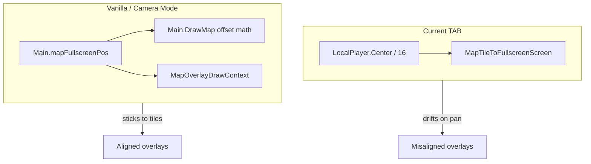

# Fix map overlay tile alignment (Camera Mode / snapshot model)

## Problem diagnosis

The current implementation in [`src/UI/OverlaySystem.cs`](src/UI/OverlaySystem.cs) and [`src/Core/Client/ArchitectMapInput.cs`](src/Core/Client/ArchitectMapInput.cs) assumes the fullscreen map is **always centered on the player**:

```449:454:src/UI/OverlaySystem.cs
private static Vector2 MapTileToFullscreenScreen(Point tile, float pixelsPerTile)
{
    Vector2 screenCenter = new(Main.screenWidth / 2f, Main.screenHeight / 2f);
    Vector2 playerTile = Main.LocalPlayer.Center / 16f;
    Vector2 delta = new Vector2(tile.X, tile.Y) - playerTile;
    return screenCenter + delta * pixelsPerTile;
}
```

Vanilla does **not** work this way. The fullscreen map is a **pannable, zoomable view** of the baked `mapTexture`, anchored by [`Main.mapFullscreenPos`](https://docs.tmodloader.net/docs/stable/class_main.html) (tile coordinate at the view center) and [`Main.mapFullscreenScale`](https://docs.tmodloader.net/docs/stable/class_main.html). When the player drags the map, `mapFullscreenPos` updates but the player does not move — overlays anchored to the player drift off tiles.

There is a **second bug**: mixed rendering strategies.

| Primitive | Current approach | Issue |
|-----------|------------------|-------|
| Points, per-tile fills | `context.Draw(...)` | Scale args pass `MapScale * DrawScale`; `context.Draw` **already multiplies by `DrawScale` internally** → double-scaled icons/fills |
| Rect fills, borders | Manual `spriteBatch.Draw` + `MapTileToFullscreenScreen` | Wrong transform + bypasses context |

Cursor input in [`ArchitectMapInput.TryFullscreenMapMouseToTile`](src/Core/Client/ArchitectMapInput.cs) repeats the same player-centered mistake and adds an extra `Main.UIScale` factor that vanilla `DrawMap` does not use for tile sizing.

Downstream consumers already depend on the broken helper:

- [`SelectionControl`](src/Core/Client/Selection/SelectionControl.cs) — "Camera-mode-like" handle hit-testing via `OverlaySystem.GetTileRectangleScreenPixels` / `GetPointHandleRect`
- All tool items via `ArchitectMapInput.TryGetCursorTile`

## Reference: Terraria Camera Mode / map snapshot model

You asked to follow **Camera Mode (F4) map framing**. That system ([`Terraria.Graphics.Capture.CaptureInterface`](https://docs.tmodloader.net/docs/stable/class_capture_interface.html)) works entirely in **tile space**:

- Frame corners are stored as `EdgeA` / `EdgeB` (`Point`, tile coordinates)
- `GetArea()` returns a tile `Rectangle` used by `CaptureCamera` to render the snapshot
- `UsingMap()` indicates the user is pinning the frame from the **map UI** rather than the live world camera

When framing from the map, corner placement uses the **same map view transform** as vanilla fullscreen map hover (not player position). Vanilla `Main.DrawMap` resolves hovered tiles as:

```csharp
// Terraria Main.DrawMap (fullscreen branch)
tileX = (int)((-mapScreenOffsetX + Main.mouseX) / mapFullscreenScale + mapEdgePadding);
tileY = (int)((-mapScreenOffsetY + Main.mouseY) / mapFullscreenScale + mapEdgePadding);
```

where `mapScreenOffsetX/Y` are derived from `mapFullscreenPos`, screen center, scale, and edge padding (see decompiled `DrawMap` ~26872–26887, 27414–27415).

tModLoader exposes the **same transform for mod drawing** via [`MapOverlayDrawContext`](https://docs.tmodloader.net/docs/stable/struct_map_overlay_draw_context.html):

```csharp
// tModLoader MapOverlayDrawContext (conceptual)
screenPos = (tilePos - MapPosition) * MapScale + MapOffset;
spriteScale = DrawScale * scaleParameter;
```

For fullscreen map, `MapPosition` is `Vector2.Zero`; pan/zoom live in `MapOffset` + `MapScale`. Example mods (BossChecklist, ExampleMod pylons) pass **small icon scales (`1f`, `1.2f`)** and let the context handle map scaling — they never pass `MapScale * DrawScale`.



## Proposed changes

### 1. Add `ArchitectMapTransform` (new file under `src/Core/Client/`)

Single authority for map tile ↔ screen conversion, updated every frame the map layer draws.

**Cache context in [`ArchitectOverlayMapLayer.Draw`](src/UI/ArchitectOverlayMapLayer.cs):**

```csharp
public override void Draw(ref MapOverlayDrawContext context, ref string text)
{
    if (Main.gameMenu || !Main.mapFullscreen) return;
    ArchitectMapTransform.SetCurrent(in context);
    OverlaySystem.DrawMapOverlays(ref context);
}
```

**Expose:**

- `TileToScreen(Point tile)` — `(tile - context.MapPosition) * context.MapScale + context.MapOffset`
- `ScreenToTile(Vector2 screen)` — inverse of above
- `TryScreenToTile(Vector2 screen, out Point tile)` — floor/round consistently with vanilla `(int)` cast
- `PixelsPerTile` — `context.MapScale` (not `* UIScale * 16` manually)
- `IsContextValid` — true after layer draw this frame

For code running **outside** the map layer draw call (tool `UseItem`, `SelectionControl` hit-tests), either:

- Use the cached context from the most recent map layer draw (same frame), **or**
- Fall back to vanilla `DrawMap`-equivalent math using `Main.mapFullscreenPos`, `Main.mapFullscreenScale`, screen center, and edge padding constant (`10f` tiles in vanilla fullscreen branch)

Prefer **cached context** when valid; fallback only when needed between draw and input phases (verify frame order in-game).

### 2. Rewrite map drawing in [`OverlaySystem.cs`](src/UI/OverlaySystem.cs)

**Delete** `MapTileToFullscreenScreen`, `GetFullscreenMapPixelsPerTile`, and all direct `Main.spriteBatch.Draw` calls inside map draw methods.

**Use `context.Draw` for every tile primitive:**

| Kind | Approach |
|------|----------|
| `Point` | `context.Draw` at tile center, `Alignment.Center`, scale params ≈ handle px size (e.g. `12f`, `16f`) — **do not** multiply by `MapScale * DrawScale` |
| `TileFill` | One `context.Draw` per tile, `Alignment.TopLeft`, scale param = `TilePixelSize` (16f) so `DrawScale * 16` fills one map tile width |
| `TileRectFill` | Either per-tile draws (simple, matches fills) or one draw per rect corner with computed scale = `rect.Width * 16f` — avoid manual spriteBatch |
| `TileBounds` / `TileBorder` | Draw four edge quads via repeated `context.Draw` calls **or** convert rect corners through `ArchitectMapTransform` and draw 1px-thick lines; do not use `ModUtils.DrawBorderedRect` (world `screenPosition` path) |

Keep storing `_mapDrawContext` only for the duration of `DrawMapOverlays`; delegate transform math to `ArchitectMapTransform`.

### 3. Fix [`ArchitectMapInput.cs`](src/Core/Client/ArchitectMapInput.cs)

Replace `TryFullscreenMapMouseToTile` body with:

```csharp
Vector2 mouse = new(Main.mouseX, Main.mouseY);
if (ArchitectMapTransform.TryScreenToTile(mouse, out tile))
    return true;
```

Remove player-centered formula and remove erroneous `* Main.UIScale` on tile pixel size.

### 4. Fix hit-testing helpers in [`OverlaySystem.cs`](src/UI/OverlaySystem.cs)

- `GetPointHandleRect` (map branch) → derive center from `ArchitectMapTransform.TileToScreen(tile) + PixelsPerTile/2`
- `GetTileRectangleScreenPixels` (map branch) → top-left from transform, size = `tileBounds.Size * PixelsPerTile`

This keeps [`SelectionControl`](src/Core/Client/Selection/SelectionControl.cs) handle dragging aligned with Camera Mode-style frame interaction.

### 5. Optional Camera Mode awareness (small, recommended)

In map draw / input gates, treat **map-visible camera framing** like fullscreen map:

- Skip or no-op when `CaptureInterface.Active && !CaptureInterface.UsingMap()` (live world camera — existing world overlay path handles that)
- When `CaptureInterface.Active && CaptureInterface.UsingMap()`, use the same transform (fullscreen map is open)

No need to read `EdgeA`/`EdgeB` unless you later want selection export via `CaptureInterface.GetArea()`.

### 6. Files to touch

| File | Change |
|------|--------|
| **New** `src/Core/Client/ArchitectMapTransform.cs` | Cached context + tile/screen conversion |
| [`src/UI/ArchitectOverlayMapLayer.cs`](src/UI/ArchitectOverlayMapLayer.cs) | Set transform cache before draw |
| [`src/UI/OverlaySystem.cs`](src/UI/OverlaySystem.cs) | Unified `context.Draw` map primitives; fix hit-test helpers |
| [`src/Core/Client/ArchitectMapInput.cs`](src/Core/Client/ArchitectMapInput.cs) | Use transform inverse for cursor |
| [`.cursor/plans/map_overlay_compatibility_7d2a3f91.plan.md`](.cursor/plans/map_overlay_compatibility_7d2a3f91.plan.md) | Update implementation notes (optional) |

No changes needed to overlay registrars (`SelectionSystem`, `ProjectionSystem`, `PasteOverlayMonitor`) — they already register tile-space geometry.

## Verification

Manual in-game checklist:

1. Open fullscreen map with selection/projection visible — overlay aligns with tiles at default zoom.
2. **Pan** the map (drag with mouse) — overlay stays glued to the same world tiles (primary regression for the current bug).
3. **Zoom** in/out (scroll wheel) — overlay scales with map tiles; borders and paste fills stay aligned.
4. Pin/set with Tier 1–3 tools on map — cursor hits the tile under the mouse.
5. Drag selection handles on map — handles track correctly while panning (`SelectionControl`).
6. Open **Camera Mode (F4)**, open map, pin frame corners — architect overlays remain aligned with map tiles while framing (same transform as step 2).
7. World-mode behavior unchanged when map is closed.

## Risk notes

- **Frame timing:** If input runs before `ModMapLayer.Draw` in a frame, cached context may be stale — validate in-game; fallback vanilla math covers this.
- **Large paste overlays:** Per-tile `context.Draw` may be costly; optimize later with batched rects only after alignment is correct.
- **Screen overlays** (projection sprites, toolbox) remain world-only — unchanged.
