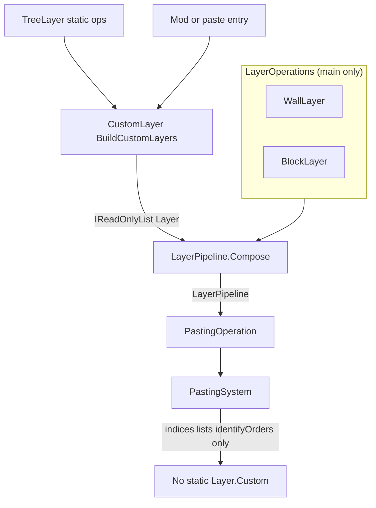

# Layer system split and Custom layer extensibility

## Current state

- Everything lives in one file (~1550 lines): `[Layer](r:\Documents\My Games\Terraria\tModLoader\ModSources\ArchitectsStencilMod\src\Core\PasteExecution\Layers.cs)` registry, shared helpers (`TileComparison`, `FrameOperations`, `TileOperations`, `LayerSync`), and all `*Layer` static classes.
- The static field is `Layer.Custom` but [`Id` is `"Tree"`](r:\Documents\My Games\Terraria\tModLoader\ModSources\ArchitectsStencilMod\src\Core\PasteExecution\Layers.cs) while [`BlockLayer` defers via `CustomLayer.IsMatch`](r:\Documents\My Games\Terraria\tModLoader\ModSources\ArchitectsStencilMod\src\Core\PasteExecution\Layers.cs) — naming is inconsistent.
- `[PastingSystem](r:\Documents\My Games\Terraria\tModLoader\ModSources\ArchitectsStencilMod\src\Core\PasteExecution\PastingSystem.cs)` hardcodes `Layer.PlaceOrder`, `Layer.ClearOrder`, `Layer.PlaceIdentifyGroups`, `Layer.ClearIdentifyGroups`, `Layer.ToPlaceIndex`, `Layer.ToClearIndex`, and a few `Layer.Wall` / `Layer.Fluid` / `Layer.Sweep` references for cheat/debug paths. Task queues are sized from those static arrays, and conflict resolution is partly implicit in those groups plus layer-specific checks like `TreeLayer.IsMatch`.

## Target architecture (PastingSystem sees only composed lists)

- Introduce **LayerPipeline** (or equivalent name), built when a **PastingOperation** starts:
  - **PlaceOrder** / **ClearOrder**: `IReadOnlyList<Layer>` — **main** static layers in the same relative order as today, with **custom `Layer` instances spliced in** at the slot where `Layer.Custom` currently sits (between `Unknown` and `OtherAnchored` in the exclusive identify group; clear/place arrays must stay consistent with that ordering).
  - **PlaceIdentifyOrder** / **ClearIdentifyOrder**: flat `IReadOnlyList<Layer>` lists in the exact order identification should run for that phase. This replaces the old group model. For each source tile, the queue builder walks the ordered list once, tracks which `**LayerType`** values have already claimed that tile, and skips later layers with the same claimed type.
  - **ToPlaceIndex(Layer)** / **ToClearIndex(Layer)**: dictionary keyed by reference equality on each `Layer` instance used in that operation (custom instances are new objects per pipeline build, so indices are stable for the lifetime of the operation).
- **PastingOperation** holds:
  - **LayerPipeline Pipeline**
  - **CustomLayers** — `IReadOnlyList<Layer>` (or equivalent); the slice used to build the pipeline, attached for diagnostics/mod hooks; default mod setup supplies at least the tree layer (`Id` e.g. `"Tree"`).
- **PastingSystem** (the inner operation runner) uses **Pipeline.PlaceOrder** / **Pipeline.ClearOrder** / **Pipeline.PlaceIdentifyOrder** / **Pipeline.ClearIdentifyOrder** / **Pipeline.ToPlaceIndex** everywhere it currently says `Layer.`*. No remaining dependency on a global `Layer.Custom` static except whatever the mod uses to **construct** defaults when building the pipeline.
- **Type shape**: Custom entries are still **Layer** — same constructors/delegates (`Id`, `Match`, `Identify`, `GetItem`, `Clear`, `Place`, `Consume`) plus a new `**LayerType`** property used for identification conflict claims. Use `**Block`** instead of `Tile` for the solid placed-layer domain, since `tile` remains the world-location/state concept. C# type name stays `Layer` (not a separate runtime custom-layer type) so **PastingSystem** stays simple. Mods add behavior with new static ops classes and wire them in `CustomLayer.BuildCustomLayers()`.

## Conflict handling (`LayerType`)

- Use an **enum**, not a string or bool:
  - **bool** is too small; the system has more than two conflict domains.
  - **string** is typo-prone and makes branch logic noisier.
  - **enum LayerType** is explicit, cheap, and can still have numeric backing internally.
- Add `LayerType` to each `Layer`. Initial values should model claim domains, not exact implementation class names. Example starting set:
  - `Wall`
  - `Block`
  - `Frame`
  - `Liquid`
  - `Paint`
  - `Wiring`
  - `Detail`
  - `Sweep`
- Expected mapping:
  - `WallLayer` -> `Wall`
  - `BlockLayer`, `FallBlockLayer`, `UnknownLayer`, `TreeLayer` -> `Block`
  - `TileAnchoredLayer`, `WallAnchoredLayer`, `OtherAnchoredLayer` -> `Frame`
  - `FluidLayer` -> `Liquid`
  - `PaintLayer` -> `Paint`
  - `WiringLayer` -> `Wiring`
  - `DetailLayer` -> `Detail`
  - `SweepLayer` -> `Sweep`
- Identification algorithm for both clear/place:
  - Start with an empty set of claimed `LayerType`s for the current source tile.
  - Walk the phase's ordered identification list.
  - If the current layer's `LayerType` is already claimed, skip it.
  - If `Identify(...)` returns tiles, queue the task and mark that `LayerType` as claimed.
- This resolves the current conflicts cleanly:
  - **Tree vs Block**: both are `Block`, so whichever comes first in identify order wins.
  - **Anchored layer overlap**: all anchored-object layers are `Frame`, so the first matching frame layer wins.
  - **Paint/Wiring/Detail** still all run because they each use a different `LayerType`.
- Custom layers choose their own `LayerType` when assembled:
  - tree-like customs -> `Block`
  - furniture-like customs -> `Frame`
  - future wall-special customs -> `Wall`

## Target folder layout

Under `src/Core/PasteExecution/Layers/`:

### Root (registry + shared cross-layer helpers)

| File               | Contents                                                                                                                                                                                                       |
| ------------------ | -------------------------------------------------------------------------------------------------------------------------------------------------------------------------------------------------------------- |
| `Layer.cs`         | `Layer` sealed class + `LayerType` enum metadata. **Static** `MainPlaceOrder` / `MainClearOrder` / base identify-order templates without custom slots (or with a placeholder marker replaced at compose time). |
| `LayerPipeline.cs` | Immutable (or struct) aggregate: composed `PlaceOrder`, `ClearOrder`, phase-specific identify orders, `ToPlaceIndex` / `ToClearIndex`. Factory: `LayerPipeline.Compose(IReadOnlyList<Layer> customLayers)`.    |
| `LayerHelpers.cs`  | Shared helper container file holding `TileComparison`, `FrameOperations`, and `TileOperations` as internal helper types.                                                                                       |

### Subfolder `LayerOperations/` (paste-layer implementations)

| File                               | Contents                                                                                                 |
| ---------------------------------- | -------------------------------------------------------------------------------------------------------- |
| `WallLayer.cs` … `UnknownLayer.cs` | One file per existing **main** `*Layer` static class only — **no** merged custom orchestrator file here. |

### Subfolder `CustomOperations/` (custom *implementations* + wiring)

| File             | Role                                                                                                                                                                                                                                                                                                                                  |
| ---------------- | ------------------------------------------------------------------------------------------------------------------------------------------------------------------------------------------------------------------------------------------------------------------------------------------------------------------------------------- |
| `TreeLayer.cs`   | Same **shape as main layers**: `internal static class TreeLayer` with `Identify`, `GetItem`, `Clear`, `Place`, `Consume`, `Match` (if needed), and stable id constant (e.g. `Id = "Tree"`). **No** `new Layer(...)` here — only logic, like `WallLayer`.                                                                              |
| *Future files*   | e.g. `MyModLayer.cs` — same pattern: static ops + distinct id.                                                                                                                                                                                                                                                                        |
| `CustomLayer.cs` | **Intermediary only**: builds each custom paste row with `new Layer(id: TreeLayer.Id, match: TreeLayer.Match, identify: TreeLayer.Identify, …)` (and future siblings), returns `IReadOnlyList<Layer>` (e.g. `BuildCustomLayers()`). **PastingOperation** / pipeline consume that list only and do not reference `TreeLayer` directly. |

**PastingSystem** still only ever sees composed **Layer** instances in the pipeline; it does not call `TreeLayer.Identify` directly.

Namespaces: **ArchitectsStencilMod.Core.Layers** everywhere so call sites stay unchanged aside from receiving a **LayerPipeline**.

Remove the old `[Layers.cs](r:\Documents\My Games\Terraria\tModLoader\ModSources\ArchitectsStencilMod\src\Core\PasteExecution\Layers.cs)` after the move (SDK-style csproj picks up new `.cs` files automatically).

## Layer ids and config (varying custom names)

- Each **custom** paste row is a normal **Layer** instance with its own **Id** (e.g. `"Tree"`, later `"MyModFoo"`). `PastingConfig.IsLayerIdentificationEnabled(layer.Id)` stays the gate per queued layer.
- **Main** ids unchanged (`Wall`, `Block`, …). Drop the old single static `Layer.Custom` with a confusing id; **N custom `Layer` instances** are produced by **CustomLayer** from registered static ops (**TreeLayer**, …) and attached to the operation.
- **Config file in scope:** `[src/Config/PastingConfig.cs](r:\Documents\My Games\Terraria\tModLoader\ModSources\ArchitectsStencilMod\src\Config\PastingConfig.cs)` only.
- Update `LayerIdentificationSettings` in `PastingConfig.cs` to match the final built-in layer ids after the refactor. For this plan that means keeping the existing built-in toggles and continuing to expose `Tree` as the built-in custom layer toggle.
- Update `PastingConfig.IsLayerIdentificationEnabled(string layerId)` so it remains aligned with the runtime `Layer.Id` values produced by `Layer` / `CustomLayer`.
- `TileMappingConfig.cs` is **not** part of this refactor.
- Localization changes, if needed, should be limited to labels/tooltips for built-in layer toggles already exposed by `PastingConfig.cs`.

## Block deferral and optional wall customs

- **Block deferral**: no separate special-case predicate. `TreeLayer` and any other custom block claimant simply run earlier in identify order with `LayerType.Block`, so `BlockLayer` is skipped after that claim is taken.
- **Per-Layer dispatch**: Each custom `Layer` carries its own **Identify / GetItem / Clear / Place / Consume** (and **Match** if used). No secondary dispatch layer — the queued task already references the correct **Layer** instance (**fixes** the old “re-resolve handler” problem).
- **Wall**: no special seam required for the basic design. A custom wall layer can just be another `Layer` with `LayerType.Wall` placed before `WallLayer` in the identify order when needed. This stays optional and out of the first implementation pass unless needed by an actual built-in custom layer.

## Registry composition (static vs runtime)

- **Layer** exposes **only main** static fields (`Wall` … `Unknown`); **no** `Custom` singleton.
- `**LayerPipeline.Compose(IReadOnlyList<Layer> customLayers)`** splices **each** custom instance into **PlaceOrder**, **ClearOrder**, and into phase-specific identify orders at the former single-custom slot, preserving order: Unknown → **customs in list order** → OtherAnchored → … → Block.

## Dependency / compile order

- `TreeLayer` (and siblings) → static helpers only; same dependencies as today’s tree block (`TileOperations`, etc.) now co-located in `LayerHelpers.cs`.
- `CustomLayer` → references `TreeLayer`, … and **Layer** constructor; produces `**IReadOnlyList<Layer>`** for the pipeline.
- `LayerPipeline` → references main `Layer` statics + list from `CustomLayer` (or caller passes the list built via `CustomLayer`).
- `BlockLayer` → no custom-specific dependency; conflict resolution comes from identify order + `LayerType.Block` claim tracking.

## Files to touch (summary)

- Add: `src/Core/PasteExecution/Layers/Layer.cs`, `LayerPipeline.cs`, `LayerHelpers.cs`, `Layers/LayerOperations/*.cs`, `Layers/CustomOperations/*.cs`.
- Delete: `src/Core/PasteExecution/Layers.cs`.
- Edit: `[PastingSystem.cs](r:\Documents\My Games\Terraria\tModLoader\ModSources\ArchitectsStencilMod\src\Core\PasteExecution\PastingSystem.cs)` — operation construction passes **LayerPipeline**; inner runner uses **pipeline.PlaceOrder.Length**, **pipeline.ToPlaceIndex**, **pipeline.PlaceIdentifyOrder** / **pipeline.ClearIdentifyOrder**, and per-tile claimed-`LayerType` tracking during identification. Cheat-path layers (`Wall`, `Fluid`, `Sweep`) still resolve via indices from the same pipeline (lookup by id or keep references to main static `Layer.Wall` if those instances are identical references in the composed list — **must use the same `Layer` reference as in `PlaceOrder`** for `ToPlaceIndex` to work).
- Edit: paste operation constructor / `[PastingSystem](r:\Documents\My Games\Terraria\tModLoader\ModSources\ArchitectsStencilMod\src\Core\PasteExecution\PastingSystem.cs)` entry that creates `PastingOperation` — attach `**IReadOnlyList<Layer>` customLayers** (default from mod static list).
- Edit: `[PastingConfig.cs](r:\Documents\My Games\Terraria\tModLoader\ModSources\ArchitectsStencilMod\src\Config\PastingConfig.cs)`, plus localization only if a built-in layer label changes.
- Do not touch `TileMappingConfig.cs` for this refactor.
- Optional later: built-in wall-custom support as above.

**Reference equality caveat:** Composed **PlaceOrder** must contain the **exact** `Layer` instances used when queuing tasks, so `ToPlaceIndex(layer)` matches. Main layers should be the **same** static instances as today (`Layer.Wall`, etc.), spliced into new arrays by reference — do not clone main layers.