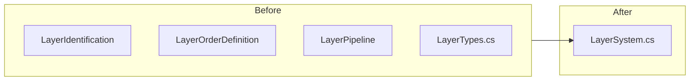

# LayerSystem follow-up refactor

## Context

- `[Layer.cs](r:\Documents\My Games\Terraria\tModLoader\ModSources\ArchitectsStencilMod\src\Core\PasteExecution\Layers\Layer.cs)` defines `LayerType`, the `Layer` sealed class, `MainLayers`, and three `**Legacy*Order**` lists that duplicate the same sequences as `[LayerOrderDefinition.CreateDefault()](r:\Documents\My Games\Terraria\tModLoader\ModSources\ArchitectsStencilMod\src\Core\PasteExecution\Layers\LayerOrderDefinition.cs)` / `[Content/Config/LayerOrder.json](r:\Documents\My Games\Terraria\tModLoader\ModSources\ArchitectsStencilMod\Content\Config\LayerOrder.json)`.
- `[LayerPipeline.ResolveOrder](r:\Documents\My Games\Terraria\tModLoader\ModSources\ArchitectsStencilMod\src\Core\PasteExecution\Layers\LayerPipeline.cs)` applies JSON (or `CreateDefault` ids), then **again** merges `Legacy*Order`, then appends unseen registry layers. The Legacy pass is redundant once defaults and JSON share the same id lists.
- `[LayerTypes.cs](r:\Documents\My Games\Terraria\tModLoader\ModSources\ArchitectsStencilMod\src\Core\PasteExecution\LayerTypes.cs)` is a misnamed home for `**LayerResult`** and `**SourceTileLookup`** (not `LayerType`).

## 1. Make `Layer` more descriptive (focused, no scope creep)

- **Property clarity:** Rename the `Layer.LayerType` property to `**ClaimDomain`** (or `**IdentificationDomain`**) so call sites read naturally (`layer.ClaimDomain` vs `layer.LayerType`). Keep the enum name `**LayerType`** unless you prefer renaming it to `LayerClaimDomain` everywhere (more churn across `[LayerPipeline](r:\Documents\My Games\Terraria\tModLoader\ModSources\ArchitectsStencilMod\src\Core\PasteExecution\Layers\LayerPipeline.cs)`, `[LayerIdentification](r:\Documents\My Games\Terraria\tModLoader\ModSources\ArchitectsStencilMod\src\Core\PasteExecution\Layers\LayerIdentification.cs)`, and all `Layer` initializers).
- **Delegates:** Give public-facing typedefs clearer names in XML summary and, where low-churn, rename internal delegate types (e.g. `IdentifyDelegate` → `LayerIdentifyHandler`) so signatures in `[Layer.cs](r:\Documents\My Games\Terraria\tModLoader\ModSources\ArchitectsStencilMod\src\Core\PasteExecution\Layers\Layer.cs)` read as documentation.
- **Constructor:** Keep the same behavior; expand XML on `id` (stable config key), delegates (identify returns `null` when N/A), and the optional `Match` hook.
- `**IsMatch` vs. `Layer.Match`:** Do not use the name `IsMatch` for custom-layer **tile-type classification** used in **Identify** (and in exclusions such as `BlockLayer` deferring to the Tree layer). That is a different concern from the layer’s optional `**Match(PasteTile)`** delegate, which runs when **materializing tasks** to skip no-op paste/clear rows. Rename the static helpers to unambiguous names—for example `TreeLayer.IsTreeFamilyTileType` (or `ClassifiesAsTreeTileType`) and a corresponding forwarder on `CustomLayer` such as `IsHandledByCustomBlockLayer` / `IsCustomTreeClaimTileType`—so they cannot be read as the same API as main `Layer` behavior.

## 2. Unify identification, order, pipeline, and shared types under `**LayerSystem`**

**Physical layout (recommended):** one module file to replace four:

| Remove                                                                                                                                                        | Replace with                                                                                                                                                                                          |
| ------------------------------------------------------------------------------------------------------------------------------------------------------------- | ----------------------------------------------------------------------------------------------------------------------------------------------------------------------------------------------------- |
| `[LayerIdentification.cs](r:\Documents\My Games\Terraria\tModLoader\ModSources\ArchitectsStencilMod\src\Core\PasteExecution\Layers\LayerIdentification.cs)`   | `LayerSystem.Identify(...)` (static entrypoint)                                                                                                                                                       |
| `[LayerOrderDefinition.cs](r:\Documents\My Games\Terraria\tModLoader\ModSources\ArchitectsStencilMod\src\Core\PasteExecution\Layers\LayerOrderDefinition.cs)` | Nested/internal `LayerOrderDefinition` + `Load` next to pipeline                                                                                                                                      |
| `[LayerPipeline.cs](r:\Documents\My Games\Terraria\tModLoader\ModSources\ArchitectsStencilMod\src\Core\PasteExecution\Layers\LayerPipeline.cs)`               | Same type, either **nested** `LayerSystem.Pipeline` **or** top-level `LayerPipeline` in the same file to avoid a massive type-prefix churn                                                            |
| `[LayerTypes.cs](r:\Documents\My Games\Terraria\tModLoader\ModSources\ArchitectsStencilMod\src\Core\PasteExecution\LayerTypes.cs)`                            | `LayerResult`, `SourceTileLookup` moved into `[Layers/LayerSystem.cs](r:\Documents\My Games\Terraria\tModLoader\ModSources\ArchitectsStencilMod\src\Core\PasteExecution\Layers\LayerSystem.cs)` (new) |

- Keep `**namespace ArchitectsStencilMod.Core.Layers`** so layer operation files under `LayerOperations/` / `CustomOperations/` do not need mass namespace edits unless you explicitly want `Core.LayerSystem` (would touch every consumer).
- **API shape:** Prefer `internal static class LayerSystem` with `Identify` plus `ComposePipeline(IReadOnlyList<Layer> customLayers)` delegating to the existing pipeline constructor logic, so `[PastingSystem](r:\Documents\My Games\Terraria\tModLoader\ModSources\ArchitectsStencilMod\src\Core\PasteExecution\PastingSystem.cs)` has one obvious entrypoint for “build runtime layer graph.”

## 3. Retire unnecessary legacy handling

- **Delete** `LegacyPlaceOrder`, `LegacyClearOrder`, and `LegacyIdentifyOrder` from `[Layer.cs](r:\Documents\My Games\Terraria\tModLoader\ModSources\ArchitectsStencilMod\src\Core\PasteExecution\Layers\Layer.cs)`.
- **Refactor `ResolveOrder`** in the new `LayerSystem` module to:
  1. Emit layers in order for each **configured id** (from loaded JSON or from `CreateDefault()` when resource load/deserialize fails).
  2. Append any **registered** layer not yet present (keep `**InsertNearMatchingDomain`** for sane ordering of new/custom ids not listed in JSON).
- **Single source of truth for default ids:** Keep string lists only in `CreateDefault()` (or load always succeeds when the embedded resource is present—then defaults are strictly the failure path). Ensure `[LayerOrder.json](r:\Documents\My Games\Terraria\tModLoader\ModSources\ArchitectsStencilMod\Content\Config\LayerOrder.json)` stays aligned with `CreateDefault()` when you change ordering.

This removes duplicate maintenance between Legacy arrays and JSON/defaults.

## 4. Update `**PastingSystem`** (and direct consumers)

- [`PastingOperation` constructor](r:\Documents\My Games\Terraria\tModLoader\ModSources\ArchitectsStencilMod\src\Core\PasteExecution\PastingSystem.cs): replace `LayerPipeline.Compose(CustomLayers)` with `LayerSystem.ComposePipeline(CustomLayers)` (or equivalent).
- `QueueClearLayersForTile` / `QueuePlaceLayersForTile`: replace `LayerIdentification.Identify(...)` with `LayerSystem.Identify(...)`.
- `[PasteTaskMapDebug.cs](r:\Documents\My Games\Terraria\tModLoader\ModSources\ArchitectsStencilMod\src\Debug\PasteTaskMapDebug.cs)`: no behavior change if `LayerPipeline` type name is preserved; if nested under `LayerSystem`, update parameter types.
- **Project file:** No change expected unless an explicit compile item referenced deleted paths (unlikely for implicit `**/*.cs`).

## 5. Verification

- `dotnet build` on `[ArchitectsStencilMod.csproj](r:\Documents\My Games\Terraria\tModLoader\ModSources\ArchitectsStencilMod\ArchitectsStencilMod.csproj)`.
- Quick grep for removed symbols (`LegacyPlaceOrder`, `LayerIdentification`, old `LayerTypes.cs` path) to ensure no stale references.

