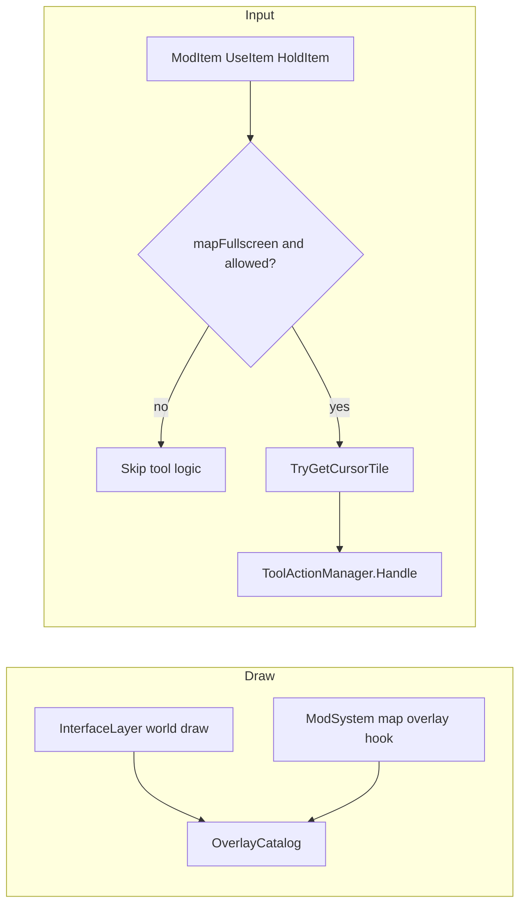

# Map compatibility: overlays + Tier 4/5 tool input

## Goals (from notes)

1. **Overlays on the fullscreen map** — When `Main.mapFullscreen`, blueprint/projection visuals should appear aligned to the map (not hidden and not misaligned).
2. **Tool interaction on the map** — Equipped tools should work against map cursor **only** for the Tier 4/5 progression (per your scope choice): lower tiers remain **world-only**.

3. **Overlay visibility** — Blueprint/projection overlays (world **and** fullscreen map) are shown **only** while the local player is **holding** one of the mod’s Architect tool items (Tier 1 sticks, Tier 2 wands, `ArchitectsStencil`, etc.). **Tier 4/5** cases where the player might expect overlays or controls **without** a tool in hand (e.g. accessory-only `ArchitectsHand`, post–`ArchitectsSoul` GUI) are **not** part of this milestone; a **later UI implementation** will own that visibility and interaction surface.

## Current behavior ([`src/UI/OverlaySystem.cs`](src/UI/OverlaySystem.cs))

- [`OverlayContext.ShouldDrawWorldOverlay`](src/UI/OverlaySystem.cs) is `!Main.gameMenu && !Main.mapFullscreen`, so **the entire catalog is skipped** while the fullscreen map is open (lines 295–305).
- World drawing uses **world camera** math: tile → screen via `Main.screenPosition` (e.g. `DrawPoints`, `DrawTileFill`, `GetPointHandleRect`). That is correct for the live world, not for the map projection.
- Tool code (e.g. items) typically resolves tiles with `Terraria.Utils.ToTileCoordinates(Main.MouseWorld)`, which does **not** match the tile under the cursor on the fullscreen map.

## Design

### A. Split draw paths: world vs map

Keep the existing **world** path (current `LegacyGameInterfaceLayer` + `Main.screenPosition` math) for normal gameplay.

Add a **map** path driven by tModLoader’s map overlay API:

- Use [`Terraria.Map.MapOverlayDrawContext`](https://docs.tmodloader.net/docs/1.4-stable/struct_terraria_1_1_map_1_1_map_overlay_draw_context.html): draw calls take positions in **tile space**; the context supplies `MapOffset`, `MapPosition`, `MapScale`, `DrawScale`, etc.
- Implement this on the same [`OverlaySystem`](src/UI/OverlaySystem.cs) (already a `ModSystem`) by **overriding the ModSystem hook** your tML version exposes for map icon / overlay drawing (exact override name may vary by tML branch—confirm in IDE against your reference assemblies; the docs center on `MapOverlayDrawContext`).

**Rendering strategy**

- **Points / small markers:** use `context.Draw` with the dummy 1×1 texture at tile `Vector2`, appropriate `Alignment` (e.g. centered), and scales derived from `DrawScale` / `MapScale` so hover enlargement still reads well.
- **Per-tile fills:** either many `Draw` calls (acceptable for small previews) or batch into fewer quads if hotspots appear in profiling.
- **Rectangular borders (tile bounds):** compute **screen-space** lines or thin quads from the tile `Rectangle` using `MapOffset`, `MapPosition`, and `MapScale` (same transform vanilla uses for map tiles—verify in one test session so corners stay pixel-aligned when zooming/panning).

Refactor slightly so `OverlayCatalog.Draw()` either accepts a **mode enum** (`World` vs `Map`) plus optional `MapOverlayDrawContext`, or register two parallel draw delegates—whichever keeps call sites in blueprint/projection code minimal.

### B. When to draw (world and map)

- **Held-tool gate (applies everywhere):** Before drawing the catalog in either path, require `Main.LocalPlayer` to be holding **any** Architect mod tool (central helper, e.g. `IsHoldingAnyArchitectTool(Player)` keyed off `ModContent.ItemType<>` for sticks, wands, stencil, debug stick if applicable). If not holding a tool, **skip the entire overlay draw** even if the catalog still has entries (call sites may keep registering; draw is a no-op when unarmed).
- **Map path:** When the fullscreen map is open (and not main menu), run the map-specific draw **only if** the held-tool gate passes—same as world. Remove the blanket “skip all overlays when `mapFullscreen`” behavior, but replace it with map-aware drawing instead of world math.
- **Tier 4/5:** Do **not** add special overlay visibility rules for Hand/Soul in this task. Future UI will decide when overlays or chrome appear for accessory-only / consumable-upgrade flows.

### C. Map cursor + Tier 4/5-only tool routing

**Eligibility (player progression)**

- **`ArchitectsHand` equipped** in an accessory slot (once that item exists), **or**
- **`ArchitectsSoul` permanent flag** on a small [`ModPlayer`](https://github.com/tModLoader/tModLoader/wiki/Basic-Player) (set when the consumable is used—Soul is currently a stub in [`Content/Items/Tier4/ArchitectsSoul.cs`](Content/Items/Tier4/ArchitectsSoul.cs)).

**Held-item restriction (“lower tiers world-only”)**

- Only allow map-based gestures when the **selected item** is an **allowed high-tier tool**—minimal whitelist to implement: [`ArchitectsStencil`](Content/Items/Tier3/ArchitectsStencil.cs) and, if it becomes a usable tool, [`ArchitectsHand`](Content/Items/Tier4/ArchitectsHand.cs). **Exclude** Tier 1 sticks and Tier 2 wands by type.

**Cursor resolution**

- Add a single helper (e.g. `ArchitectMapInput.TryGetCursorTile(Player player, out Point tile)` in `src/UI` or `src/Core/Client`):
  - If **not** `Main.mapFullscreen`: use existing `ToTileCoordinates(Main.MouseWorld)`.
  - If **map fullscreen** and **not** (`CanUseMapTools(player)` **and** `IsAllowedHeldItem(player)`): **do not** run architect tool logic in `UseItem` / `HoldItem` (return early / no-op) so lower-tier tools never act on bogus coordinates.
  - If **map fullscreen** and allowed: convert **screen mouse** to **map tile** using the same approach as vanilla’s map (inspect `Main` / `MapHelper` / decompiled map update in your tML version—this is the “Terraria API” the notes refer to).

**Call sites**

- Every mod item that calls `ToolActionManager.Handle(..., cursorTile)` should obtain `cursorTile` via the helper instead of inlining `MouseWorld` (PinStick-style items, wands, stencil, etc.). Centralizing avoids drift.

**Hit-testing**

- [`GetPointHandleRect`](src/UI/OverlaySystem.cs) is used for hover sizing in `DrawPoints`; add a **map-mode** equivalent that returns a screen `Rectangle` consistent with the map transform so handles highlight correctly when the map is open.

### D. Files likely touched

| Area | File(s) |
|------|---------|
| Overlays + hook | [`src/UI/OverlaySystem.cs`](src/UI/OverlaySystem.cs) |
| Cursor + gates | New small static class or partial in UI/Core client |
| Items | [`Content/Items/**/*.cs`](Content/Items/) that pass `cursorTile` into `ToolActionManager` |
| Soul / Hand progression | [`Content/Items/Tier4/ArchitectsSoul.cs`](Content/Items/Tier4/ArchitectsSoul.cs), new `ModPlayer`, optional `ArchitectsHand` when added |

### E. Verification

- With blueprint/projection active but **no** Architect tool selected: **no** overlays in world or on fullscreen map.
- Holding **any** Architect tool: overlays show in world as today (unchanged aside from gate); on fullscreen map they align when panning/zooming.
- With **no** Hand/Soul: map open + Tier 1 tool — **no** architect **map** interaction (world still works when not on map).
- With Hand **or** Soul flag + **ArchitectsStencil** held: clicks/drags on the map hit the expected tiles and drive the same systems as in-world.
- Regression: world-mode tool behavior unchanged when not using the map.

