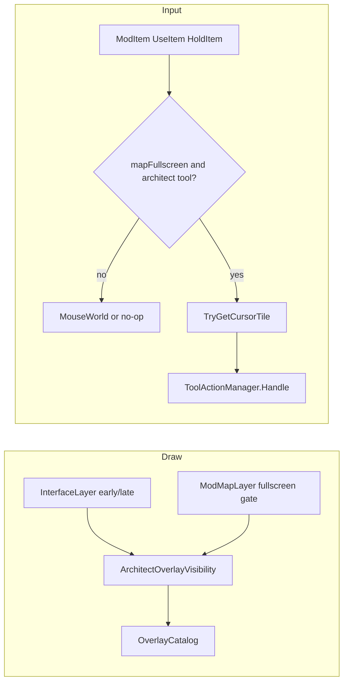

# Map compatibility: overlays + tool input

## Goals (from [src/#notes.md](src/%23notes.md))

1. **Overlays on the fullscreen map** — When `Main.mapFullscreen`, blueprint/projection visuals should appear aligned to the map (not hidden and not misaligned).
2. **Tool interaction on the map** — **Any** held architect tool (Tier 1 sticks, Tier 2 wands, `ArchitectsStencil`, `DebugStick`, etc.) should resolve the map cursor and drive the same `ToolActionManager` flows as in-world. No Tier 4/5 progression, accessory, or held-item whitelist.
3. **Overlay visibility** — Same rules as world today: overlays draw while the local player holds a tool whose `ArchitectOverlayScope` matches the overlay family (via [`ArchitectOverlayVisibility`](src/Core/Client/ArchitectOverlayVisibility.cs)). Accessory-only / GUI-only visibility (e.g. `ArchitectsHand`, `ArchitectsBlueprint`) remains deferred to a later UI milestone.

## Current behavior ([`src/UI/OverlaySystem.cs`](src/UI/OverlaySystem.cs))

- [`OverlayContext.ShouldDrawWorldOverlay`](src/UI/OverlaySystem.cs) is `!Main.gameMenu && !Main.mapFullscreen`, so **the entire catalog is skipped** while the fullscreen map is open (see `DrawOverlayEarly` / `DrawOverlayLate`, ~lines 345–372).
- World drawing uses **world camera** math: tile → screen via `Main.screenPosition` (e.g. `DrawPoints`, `DrawTileFill`, `DrawTileBounds` via `ModUtils.DrawBorderedRect`, `GetPointHandleRect`). Correct for live world, not for the map projection.
- Tool code (e.g. items) resolves tiles with `Terraria.Utils.ToTileCoordinates(Main.MouseWorld)`, which does **not** match the tile under the cursor on the fullscreen map.
- **Visibility is scope-based** via [`ArchitectOverlayVisibility`](src/Core/Client/ArchitectOverlayVisibility.cs) + [`ArchitectOverlayPlayer`](src/Core/Client/ArchitectOverlayPlayer.cs). World draw filters per overlay family through `IsOverlayFamilyVisible` — reuse on the map path unchanged.
- **Overlay catalog has grown** since the initial draft: two-pass draw (early borders/points, late fills), `TileRectFill` / `RegPasteTileFill` (paste progress via [`PasteOverlayMonitor`](src/Core/Client/PasteOverlayMonitor.cs)), and `Screen` drawables (projection sprite preview via [`PayloadPreview`](src/Core/Client/Preview/PayloadPreview.cs), toolbox via [`ProjectionToolboxControl`](src/UI/ProjectionToolboxControl.cs)).

## Design

### A. Split draw paths: world vs map

Keep the existing **world** path (current `LegacyGameInterfaceLayer` early/late passes + `Main.screenPosition` math) for normal gameplay.

Add a **map** path driven by tModLoader’s map overlay API:

- Use [`ModMapLayer`](https://docs.tmodloader.net/docs/stable/class_mod_map_layer.html) with `Draw(ref MapOverlayDrawContext context, ref string text)` — **not** a generic ModSystem override. `ModMapLayer` is the current tML entry point for custom map drawing.
- Add a thin layer class (e.g. `ArchitectOverlayMapLayer` under `src/UI/`) that delegates to catalog draw methods on [`OverlaySystem`](src/UI/OverlaySystem.cs).
- Use [`MapOverlayDrawContext`](https://docs.tmodloader.net/docs/stable/struct_map_overlay_draw_context.html): draw calls take positions in **tile space**; the context supplies `MapOffset`, `MapPosition`, `MapScale`, `DrawScale`, etc.
- **Gate to fullscreen only:** `ModMapLayer` runs for fullscreen map, overlay map, and minimap. Inside `Draw`, return early unless `Main.mapFullscreen` (and not `Main.gameMenu`). Minimap/overlay-map drawing is **out of scope** for this milestone unless testing shows it is trivially correct.

**Drawable coverage**

| Kind | Map support | Notes |
|------|-------------|-------|
| `Point` | Yes | `context.Draw` at tile `Vector2`, centered alignment |
| `TileFill` | Yes | Per-tile or batched `context.Draw` calls |
| `TileRectFill` | Yes | Paste overlays (`RegPasteTileFill`); batch rects |
| `TileBounds` / `TileBorder` | Yes | Map-space lines/quads from tile `Rectangle` + context transforms; replace `ModUtils.DrawBorderedRect` screenPosition path |
| `Screen` | **No (world-only)** | Projection sprites (`PayloadPreview.Draw`) and toolbox UI (`ProjectionToolboxControl`) use world/screen coordinates — skip on map path |

**Rendering strategy**

- **Points / small markers:** use `context.Draw` with the dummy 1×1 texture at tile `Vector2`, appropriate `Alignment` (e.g. centered), and scales derived from `DrawScale` / `MapScale` so hover enlargement still reads well.
- **Per-tile fills:** either many `Draw` calls (acceptable for small previews) or batch into fewer quads if hotspots appear in profiling.
- **Rectangular borders (tile bounds):** compute screen-space lines or thin quads from the tile `Rectangle` using `MapOffset`, `MapPosition`, and `MapScale` (same transform vanilla uses for map tiles — verify in one test session so corners stay pixel-aligned when zooming/panning).
- **Two-pass ordering:** Mirror the world path’s early/late fill split on the map path so borders/points draw before fills where z-order matters.

Refactor so `OverlayCatalog.Draw()` accepts a **mode enum** (`World` vs `Map`) plus optional `MapOverlayDrawContext`, routing each `OverlayDrawableKind` to the correct transform. Call sites in blueprint/projection/paste code stay unchanged.

### B. When to draw (world and map)

- **Scope gate (applies everywhere, unchanged):** Reuse `IsOverlayFamilyVisible` / `ArchitectOverlayVisibility.IsFamilyVisible(family, heldScope)` on **both** world and map paths. Each overlay family only draws when the held tool’s scope includes the required bits. If `heldScope == ArchitectOverlayScope.None` (vanilla item or empty hand), skip all overlay families.
- **Map path:** When `Main.mapFullscreen` (and not main menu), run map-specific draw with the same scope filtering as world. Remove the blanket “skip all overlays when `mapFullscreen`” behavior from the world path only; map path replaces it with map-aware drawing.

**Registered tools** ([`ArchitectOverlayVisibility.OnModLoad`](src/Core/Client/ArchitectOverlayVisibility.cs)): Tier 1 sticks, Tier 2 wands, `ArchitectsStencil`, `DebugStick`.

### C. Map cursor + tool routing

**Eligibility**

- **Any registered architect tool** in the held slot: `ArchitectOverlayVisibility.GetItemScope(heldItem.type) != ArchitectOverlayScope.None`.
- No `ArchitectsHand` accessory check, no `ArchitectsBlueprint` progression flag, no Stencil-only whitelist. Lower-tier sticks and wands behave on the map the same as higher-tier tools.

**Cursor resolution**

- Add a single helper (e.g. `ArchitectMapInput.TryGetCursorTile(Player player, out Point tile)` in `src/Core/Client/`):
  - If **not** `Main.mapFullscreen`: use `ToTileCoordinates(Main.MouseWorld)` (unchanged).
  - If **map fullscreen** and held item is **not** an architect tool: return false / let caller no-op (vanilla items should not run architect logic on bogus map coordinates).
  - If **map fullscreen** and held item **is** an architect tool: convert **screen mouse** to **map tile** using vanilla’s map math (inspect `Main` / `MapHelper` / decompiled map update in your tML version).

Optional convenience: `IsArchitectTool(int itemType)` wraps `GetItemScope(itemType) != None`.

**Call sites**

- Every mod item that calls `ToolActionManager.Handle(..., cursorTile)` should obtain `cursorTile` via the helper instead of inlining `MouseWorld` (all Tier 1–3 tool items, `DebugStick`, and [`ScenarioTestGuards`](src/tests/scenarios/ScenarioTestGuards.cs) if applicable). Items that are not architect tools need no changes.

**Hit-testing**

- [`GetPointHandleRect`](src/UI/OverlaySystem.cs) is used for hover sizing in `DrawPoints`; add a **map-mode** equivalent that returns a screen `Rectangle` consistent with the map transform so handles highlight correctly when the map is open.

### D. Files likely touched

| Area | File(s) |
|------|---------|
| Map layer (new) | New `ArchitectOverlayMapLayer` (or similar) under `src/UI/` |
| Overlays + transforms | [`src/UI/OverlaySystem.cs`](src/UI/OverlaySystem.cs) |
| Visibility (reuse as-is) | [`src/Core/Client/ArchitectOverlayVisibility.cs`](src/Core/Client/ArchitectOverlayVisibility.cs), [`src/Core/Client/ArchitectOverlayPlayer.cs`](src/Core/Client/ArchitectOverlayPlayer.cs) |
| Cursor helper | New static class in `src/Core/Client/` (e.g. `ArchitectMapInput.cs`) |
| Items | [`Content/Items/**/*.cs`](Content/Items/) that pass `cursorTile` into `ToolActionManager` |
| Overlay registrars (no API changes expected) | [`SelectionSystem`](src/Core/Client/Selection/SelectionSystem.cs), [`ProjectionSystem`](src/Core/Client/Projection/ProjectionSystem.cs), [`InclusionControl`](src/Core/Client/Selection/InclusionControl.cs), [`PasteOverlayMonitor`](src/Core/Client/PasteOverlayMonitor.cs) |
| World-only (no map port) | [`ProjectionToolboxControl`](src/UI/ProjectionToolboxControl.cs), [`PayloadPreview`](src/Core/Client/Preview/PayloadPreview.cs) — `Screen` kind skipped on map |

### E. Verification

- With blueprint/projection active but **no** architect tool held (`heldScope == None`): **no** overlays in world or on fullscreen map.
- Holding a **selection** tool (e.g. PinStick): selection overlays visible on world and map; paste overlays **not** visible (scope filtering unchanged).
- Holding a **paste** tool (e.g. PasteStick): paste overlays visible and align on map when panning/zooming.
- **Any** architect tool on fullscreen map: clicks/drags hit the expected tiles and drive the same systems as in-world (PinStick pins, SelectionWand sets, CopyStick copies, etc.).
- **Screen** overlays (projection sprites, toolbox): visible in world when scope allows; **not** drawn on fullscreen map.
- Paste in progress + paste-scoped tool held: paste tile overlays (`RegPasteTileFill`) align on map.
- Regression: world-mode tool behavior unchanged when not using the map.

