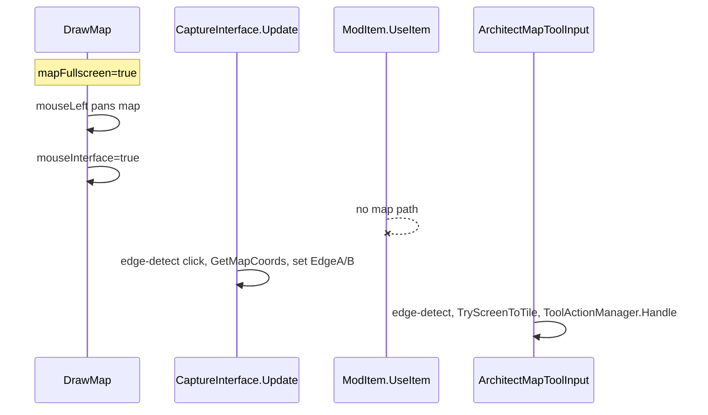

# Map input routing (Camera Mode pattern)

## Root cause

Two separate vanilla behaviors block blueprint tools on the fullscreen map:

**1. Item hooks never fire reliably**

All architect tools route gestures through `ModItem.UseItem` / `HoldItem` (e.g. [`PinStick.cs`](Content/Items/Tier1/PinStick.cs)). On fullscreen map, `Main.DrawMap` unconditionally sets `player.mouseInterface = true` every frame, and item use does not get a dedicated map path.

**2. Map pan steals left-drag**

Vanilla `DrawMap` pans on raw `Main.mouseLeft` with **no** `mouseInterface` check:

```26823:26844:C:\Users\theiterator\.cursor\projects\r-Documents-My-Games-Terraria-tModLoader-ModSources-TheArchitectsBlueprintMod\agent-tools\8ecb3f37-1c45-447c-b454-ad16a267ac36.txt
if (Main.mapFullscreen)
{
    if (Main.mouseLeft && base.IsActive)
    {
        if (Main.mouseLeftRelease) { grabMapX/Y = mouse; }
        else { /* apply delta to mapFullscreenPos */ }
    }
    Main.player[Main.myPlayer].mouseInterface = true;
}
```

Setting `mouseInterface` in our mod (as [`ProjectionToolboxControl`](src/UI/ProjectionToolboxControl.cs) does) does **not** stop panning. PIN/SET drag gestures will fight map pan unless we explicitly counter it.

## How Camera Mode handles this

Camera Mode (F4) does **not** use item hooks. [`CaptureInterface`](https://docs.tmodloader.net/docs/stable/class_capture_interface.html) is driven by `CaptureManager` with its own `Update()` loop:

- Works in **tile space** (`EdgeA` / `EdgeB` as `Point`s)
- `UsingMap()` = framing from the fullscreen map (already gated in [`ArchitectMapTransform.IsMapViewActive`](src/Core/Client/ArchitectMapTransform.cs))
- Uses private `GetMapCoords(screenX, screenY, …)` — same math family as vanilla map hover (`(-offset + mouse) / scale + padding`), which we already mirror in `ArchitectMapTransform.TryScreenToTile`
- Corner pinning uses **discrete clicks** in `Update()`, not `UseItem` — same edge-detection pattern as [`ActionWheelRuntime.UpdateUI`](src/Utils/ActionWheel.cs) and [`ProjectionToolboxControl.UpdateUI`](src/UI/ProjectionToolboxControl.cs)



## Proposed fix

### 1. Add `ArchitectMapToolInput` (`ModSystem`)

New file: [`src/Core/Client/ArchitectMapToolInput.cs`](src/Core/Client/ArchitectMapToolInput.cs)

Runs in **`UpdateUI`** (same phase as toolbox / action wheel — after `PlayerInput.UpdateInput`, uses UI-frame mouse coords).

**Gate** (mirror existing controls):

- `ArchitectMapTransform.IsMapViewActive`
- `ArchitectMapInput.IsArchitectTool(player.HeldItem.type)`
- Not `Main.gameMenu`, player active/alive
- Not `ActionWheel.IsActive` / `IsPendingOpen`
- Not `ProjectionToolboxControl.IsHovering`
- Skip when `CaptureManager.Instance.Active` and pointer is over camera UI buttons (optional: only when not `UsingMap`)

**Input loop** (edge detection, not `mouseLeftRelease`):

- Track `_prevLeftDown` / `_prevRightDown` per local player
- `leftClick = mouseLeft && !_prevLeftDown`, etc.
- Resolve tile via `ArchitectMapInput.TryGetCursorTile`
- Dispatch to `ToolActionManager.Handle(action, key, player, tile)`

**Action resolution** — add a small interface on tools that have per-item mode state:

```csharp
internal interface IArchitectMapTool
{
    ToolAction GetMapAction();
    bool TryHandleMapAltClick(Player player, Point cursorTile); // wheel open / cancel
}
```

Implement on wands/stencil (`SelectionWand`, `InclusionWand`, `ProjectionWand`, `ExecutionWand`, `ArchitectsStencil`, `DebugStick`). Sticks return a fixed action; `TryHandleMapAltClick` returns false.

This avoids duplicating `_mode` lookup logic in the router.

**Gesture parity** with existing `HoldItem` chains:

- Left click → `LeftClick`
- Left held (not first frame) → `LeftHold`
- Left up after down → `LeftRelease` (track `_leftDragSeenDown` centrally in the router)
- Right click (when left not held) → `RightClick` or delegate to `TryHandleMapAltClick` for wheel tools
- Left+right → `RightClick` cancel (same as PinStick)

### 2. Freeze map pan during tool gestures

Because vanilla pan cannot be prevented via `mouseInterface`, use **`PostDrawFullscreenMap`** (runs at end of `DrawMap`, after pan is applied):

- When router is actively gesturing (`Main.mouseLeft` held after a tool click, or any `SelectionControl`/`InclusionControl`/`ProjectionControl` `IsActivelyGesturing`), snapshot `Main.mapFullscreenPos` at gesture start
- In `PostDrawFullscreenMap`, restore `mapFullscreenPos` to the snapshot each frame

This matches how Camera Mode avoids caring about pan (click-only), but extended for blueprint drags without IL hooks.

### 3. Keep world input unchanged

Do **not** remove `UseItem`/`HoldItem` from items — they remain the world-space path. `ArchitectMapToolInput` only runs when `IsMapViewActive`.

Optional small guard in items: early-return in `UseItem`/`HoldItem` when `IsMapViewActive` to prevent double-dispatch if item hooks ever start firing on map.

### 4. Hit-testing already aligned

[`SelectionControl.BeginSet`](src/Core/Client/Selection/SelectionControl.cs) and [`OverlaySystem`](src/UI/OverlaySystem.cs) already use `ArchitectMapTransform` for map handle rects — no changes needed once input reaches `ToolActionManager`.

## Files to touch

| File | Change |
|------|--------|
| **New** [`src/Core/Client/ArchitectMapToolInput.cs`](src/Core/Client/ArchitectMapToolInput.cs) | `UpdateUI` input router + `PostDrawFullscreenMap` pan lock |
| **New** [`src/Core/Client/IArchitectMapTool.cs`](src/Core/Client/IArchitectMapTool.cs) | Interface for wand/stencil mode + alt-click wheel |
| Wand/stencil items (`SelectionWand`, `InclusionWand`, `ProjectionWand`, `ExecutionWand`, `ArchitectsStencil`, `DebugStick`) | Implement `IArchitectMapTool`; extract alt-click wheel open into `TryHandleMapAltClick` reusable from `UseItem` |
| Stick items (optional) | Early-return when `IsMapViewActive` in `UseItem`/`HoldItem` |

## Verification (manual)

1. Fullscreen map + PinStick: click/drag/release defines selection; map does not drift while dragging
2. SelectionWand SET: resize/move handles on map
3. InclusionWand INC/EXC rectangle drag on map
4. ProjectionWand COPY drag + PASTE click on map
5. Right-click on map opens action wheel for wands (when not dragging)
6. Camera Mode + map framing (`CaptureManager.UsingMap`): overlays visible, tools still work
7. World-space tool use unchanged when map closed

## Out of scope

- IL hooking `DrawMap` pan (only needed if pan-lock restore proves jittery — unlikely)
- Changing map pan to right-mouse globally
- Automated tests (per project rules)
