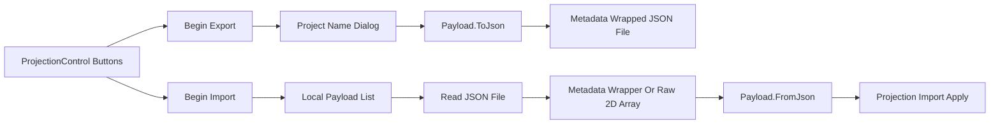

# PayloadSerialization Plan

## Scope

Build the feature around the existing client-side projection model and local mod save directory:

- [`src/Core/Client/Payload/PayloadSerialization.cs`](src/Core/Client/Payload/PayloadSerialization.cs): new client service for export/import orchestration, file discovery, metadata wrapping, and dialog launch.
- [`src/Core/Client/Payload/Payload.cs`](src/Core/Client/Payload/Payload.cs): make payload-owned JSON round-trip real via `Payload.ToJson()` and `Payload.FromJson()`.
- [`src/Core/Client/Projection/Projection.cs`](src/Core/Client/Projection/Projection.cs): add an import-specific payload replacement path that resizes target bounds and avoids stale source-cut behavior.
- [`src/Core/Client/Projection/ProjectionControl.cs`](src/Core/Client/Projection/ProjectionControl.cs): draw and handle Import/Export buttons next to the front-most local projection.
- [`src/UI`](src/UI): **all** in-game import/export modals, hosted as a `ModSystem` (or similar) with a **dedicated public API** that core code calls. No dialog drawing or input-routing in `PayloadSerialization` except through that API.

## Data Flow

## Implementation Details

Use `TileMappingSystem.GetModDirectory()` as the root and create a `Payloads` subfolder, for example `Main.SavePath/ArchitectsStencilMod/Payloads`. Export filenames should be sanitized from the entered `ProjectName`, with collision suffixes such as `Name_2.asmpayload.json`.

Define a metadata wrapper in `PayloadSerialization`:

- `metadata.format`: `ArchitectsStencilMod.Payload`
- `metadata.schemaVersion`: `1`
- `metadata.projectName`: user-entered name, defaulting to `ASMPayload{yyyyMMdd_HHmmss}`
- `metadata.createdUtc`, `metadata.modVersion`, `metadata.width`, `metadata.height`
- `payload`: the raw payload JSON owned by `Payload.ToJson()`

Keep `Payload` responsible for actual tile data serialization. The stable raw format should be a 2D array of nullable `PayloadCell.TileData` snapshots, preserving `[x, y]` payload indexing. `Payload.FromJson()` should parse that raw 2D array, create `PayloadCell`s from non-null entries, and return `Payload.Empty` for invalid or zero-sized input. `PayloadSerialization` should detect whether a file has the metadata wrapper; if not, pass the whole JSON directly to `Payload.FromJson()` to support raw 2D tile arrays from tools/mods such as Cheat Sheet.

For projection application, add an import-oriented method on `Projection`, rather than reusing `SetPayload()` directly. It should clone the payload, resize `Area` at the current top-left to `payload.Width x payload.Height`, rebuild target tiles, reset imported cells to included, force `CutSource` off, refresh inventories, and update overlays. This avoids carrying over stale selection/source semantics from the projection that happened to receive the import.

### UI in `src/UI` and its API

Implement modals **only** under [`src/UI`](src/UI) (e.g. one `ModSystem` plus private draw/update state, or a small namespace split: `...UI/PayloadExportModal.cs` / `...UI/PayloadImportModal.cs` if that keeps files readable). Reuse the same `ModSystem.UpdateUI` / `ModifyInterfaceLayers` pattern as `OverlaySystem` / `ActionWheelRuntime`.

Expose a **single entry point** that core can call, for example a static facade or public methods on a named UI host:

- `ShowExportNameDialog(string defaultProjectName, Action<string> onSave, Action onCancel)` (or `Request…` if you prefer one-shot state): text field, OK, Cancel, Terraria text input.
- `ShowImportListDialog(IReadOnlyList<…> entries, Action<string> fullFilePath, Action onCancel)`: rows for each available payload file (path + best-effort display name/size/UTC from metadata or file time).

`PayloadSerialization` (in Core) should **only** call this API to collect user input; it remains responsible for building metadata, reading/writing files under `…/ArchitectsStencilMod/Payloads`, and calling `Payload` / `Projection` methods. This keeps a clean boundary: **UI = interaction**, **PayloadSerialization = file + domain orchestration**.

Both dialogs should claim mouse/keyboard focus while open and close on cancel, completion, and world unload (UI host subscribes to `OnWorldUnload` or equivalent).

### Reference: `.OtherTools`

The repo’s **standalone UIKit** under [`r:\Documents\My Games\Terraria\tModLoader\ModSources\ArchitectsStencilMod\.OtherTools`](r:/Documents/My%20Games/Terraria/tModLoader/ModSources/ArchitectsStencilMod/.OtherTools) is not part of the mod build; use it only as a **pattern reference** when implementing the `src/UI` modals (layout, text entry, list rows, message-box affordances). Suggested files to mine for ideas (paths from repo root):

- [`r:\Documents\My Games\Terraria\tModLoader\ModSources\ArchitectsStencilMod\.OtherTools\UIKit\UITextbox.cs`](r:/Documents/My%20Games/Terraria/tModLoader/ModSources/ArchitectsStencilMod/.OtherTools/UIKit/UITextbox.cs) — text field behavior
- [`r:\Documents\My Games\Terraria\tModLoader\ModSources\ArchitectsStencilMod\.OtherTools\UIKit\UIListView.cs`](r:/Documents/My%20Games/Terraria/tModLoader/ModSources/ArchitectsStencilMod/.OtherTools/UIKit/UIListView.cs) — scrollable list selection
- [`r:\Documents\My Games\Terraria\tModLoader\ModSources\ArchitectsStencilMod\.OtherTools\UIKit\UIMessageBox.cs`](r:/Documents/My%20Games/Terraria/tModLoader/ModSources/ArchitectsStencilMod/.OtherTools/UIKit/UIMessageBox.cs) — modal-style framing
- [`r:\Documents\My Games\Terraria\tModLoader\ModSources\ArchitectsStencilMod\.OtherTools\UIKit\UIWindow.cs`](r:/Documents/My%20Games/Terraria/tModLoader/ModSources/ArchitectsStencilMod/.OtherTools/UIKit/UIWindow.cs) — window chrome / containment
- [`r:\Documents\My Games\Terraria\tModLoader\ModSources\ArchitectsStencilMod\.OtherTools\UIKit\UIScrollView.cs`](r:/Documents/My%20Games/Terraria/tModLoader/ModSources/ArchitectsStencilMod/.OtherTools/UIKit/UIScrollView.cs) and [`r:\Documents\My Games\Terraria\tModLoader\ModSources\ArchitectsStencilMod\.OtherTools\UIKit\UIScrollBar.cs`](r:/Documents/My%20Games/Terraria/tModLoader/ModSources/ArchitectsStencilMod/.OtherTools/UIKit/UIScrollBar.cs) — if the import list is long
- [`r:\Documents\My Games\Terraria\tModLoader\ModSources\ArchitectsStencilMod\.OtherTools\PaintToolsUI.cs`](r:/Documents/My%20Games/Terraria/tModLoader/ModSources/ArchitectsStencilMod/.OtherTools/PaintToolsUI.cs) and [`r:\Documents\My Games\Terraria\tModLoader\ModSources\ArchitectsStencilMod\.OtherTools\PaintToolsEx.cs`](r:/Documents/My%20Games/Terraria/tModLoader/ModSources/ArchitectsStencilMod/.OtherTools/PaintToolsEx.cs) — end-to-end panel wiring in a tool context (read-only; do not import wholesale)

New code still lives in [`src/UI`](src/UI) and must follow the **public API** contract above, not re-host the old UIKit in `src/`.

In `ProjectionControl`, add screen-space Import and Export buttons beside the front-most local projection. The projection system already treats the end of the projection list as topmost; add a small helper if needed rather than duplicating list-order assumptions in several places. Clicking Export should call `PayloadSerialization.BeginExport(projection)`. Clicking Import should call `PayloadSerialization.BeginImport(projection)`. Locked projections should either hide the buttons or reject import/export with a clear message; the safer default is hide while locked.

## Verification

No tests will be added or run unless explicitly requested. For implementation verification later, use a compile/build check if desired and manual in-game checks: export a copied projection, import it into another projection, import a raw 2D payload JSON, confirm target bounds resize, and confirm malformed files show a non-crashing error.