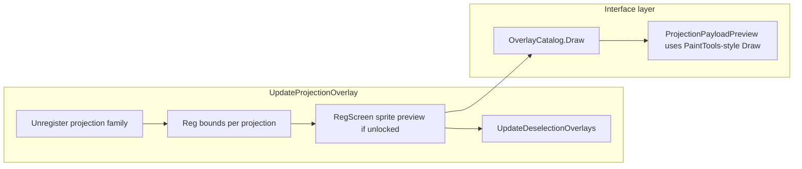

# Projection payload sprite overlay

## Behavior

- While a [`Projection`](src/Core/Client/AreaSelection/Projection.cs) is **unlocked** (`!IsLocked`), **has a payload** (`HasPayload`), and has non-empty **target** bounds, draw a **semi-transparent sprite preview** of the payload at **world tile positions** `TargetArea` (same as [`Blueprint.Bounds`](src/Core/Client/AreaSelection/Blueprint.cs) on the projection).
- While **locked**, do **not** register this overlay (paste in progress stays outline-only, matching existing border behavior in [`ProjectionSystem.UpdateProjectionOverlay`](src/Core/Client/AreaSelection/ProjectionSystem.cs)).
- **Selection**: Only draw cells that are **still selected** for paste—use `TryGetTileByRelative(relative, out var bt) && bt.Selected`, consistent with [`BuildUnselectedTilePoints`](src/Core/Client/AreaSelection/Blueprint.cs) / deselection overlays in [`SelectionSystem.UpdateDeselectionOverlays`](src/Core/Client/AreaSelection/SelectionSystem.cs). Skip empty `PayloadCell`s (`IsEmpty` or no visible wall/tile/liquid).
- **Draw order**: Register the sprite pass **after** the projection bounds entry for that index (e.g. after `RegTileBounds` / `RegTileBorder` for `{i}:b`) so tiles render **on top** of the green/red **tint** from [`ModUtils.DrawBorderedRect`](src/Utils/ModUtils.cs) but **before** the separate `projection:deselect:{who}` family runs (registered later in the same `UpdateProjectionOverlay` call), so deselected areas stay visually “masked” without drawing wasted sprites under the black fill.

## Reference rendering (PaintTools)

The stamp preview in [`.OtherTools/PaintToolsHotbar.cs`](.OtherTools/PaintToolsHotbar.cs) (`DrawPreview`, ~750–806) is the template:

- **SpriteBatch**: `End` + `Begin` with `Main.GameViewMatrix.ZoomMatrix`, `SamplerState.PointClamp`, and semi-transparent tint (`Color.White` with `A = 160`). Thumbnails call this from [`.OtherTools/PaintToolsSlot.cs`](.OtherTools/PaintToolsSlot.cs) via `PaintToolsHotbar.DrawPreview`.
- **Walls** (back): `Main.instance.LoadWall`, `TextureAssets.Wall`, frame rectangle from `TileWallWireStateData` + `Main.wallFrame[type] * 180`, draw at offset `(x*16-8, y*16-8)` for 32×32 wall sheets.
- **Wall paint**: `GetTileDrawTexture` uses `TilePaintSystemV2` via reflection on `WallDrawing` (~811–826)—same approach can be **copied into this mod** as a small private helper (avoid referencing Cheat Sheet assemblies).
- **Liquids**: `LiquidRenderer.Instance._liquidTextures` with the same height/rectangle math as PaintTools when `LiquidData.Amount > 14`.
- **Active tiles** (front): `Main.instance.LoadTiles`, `TextureAssets.Tile[type]`, source rectangle `(TileFrameX, TileFrameY, 16, 16)` when `HasTile`.

[`PayloadCell`](src/Core/Client/AreaSelection/Payload.cs) already exposes the same underlying data (`WallType`, `TileType`, `LiquidData`, `TileWallWireStateData`, etc.) via `Block` / `Wall` / `Liquid` / `Detail` facades, so the preview loop can read **frames and types** without round-tripping through `ToTile()` (avoid per-cell `Tile` allocations).

## World placement math

Match existing overlay primitives in [`OverlaySystem`](src/UI/OverlaySystem.cs): screen position from **world tile coordinates** using `(tileX * 16, tileY * 16) - Main.screenPosition`. The preview’s `position` argument should be the **screen-space top-left of the projection’s `Bounds.XY`** in that same space, then add `relative.X * 16`, `relative.Y * 16` per cell (equivalent to iterating world tiles `Bounds.X + rx`, `Bounds.Y + ry`).

**Inverted gravity**: Mirror PaintTools’ `DrawBrush` handling (`Main.LocalPlayer.gravDir == -1f` Y flip) if the preview looks wrong for flipped gravity—optional follow-up if first pass is wrong.

## Integration points

1. **New static helper** (suggested location: `src/UI/ProjectionPayloadPreview.cs` or `src/Core/Client/AreaSelection/ProjectionPayloadPreview.cs`):
   `internal static void Draw(Projection proj)`
   - Early-out if `proj.IsLocked`, `!proj.HasPayload`, or empty bounds.
   - Optional **frustum cull**: intersect payload indices with tiles that could intersect the screen using `Main.screenPosition` and `Main.screenWidth` / `Main.screenHeight` (same pattern as other games’ tile culling) to cap work on large captures.

2. **[`ProjectionSystem.UpdateProjectionOverlay`](src/Core/Client/AreaSelection/ProjectionSystem.cs)** inside the per-projection loop, after registering `{i}:b` (and source `{i}:s` when cut):
   `if (!proj.IsLocked && proj.HasPayload) OverlaySystem.RegScreen($"{i}:sprites", () => ProjectionPayloadPreview.Draw(proj), family);`

3. **No change** to [`OverlayCatalog`](src/UI/OverlaySystem.cs) required: [`RegScreen`](src/UI/OverlaySystem.cs) already supports arbitrary `Action` draw callbacks.

## Edge cases / scope limits

- **Fullscreen map**: [`OverlayContext.ShouldDrawWorldOverlay`](src/UI/OverlaySystem.cs) currently skips the whole catalog when `Main.mapFullscreen`; this preview is **world-only** until the separate [map overlay plan](.cursor/plans/map_overlay_compatibility_7d2a3f91.plan.md) adds a map draw path.
- **Block tile paint** (not wall): PaintTools preview does not paint-tint blocks; matching that keeps scope small. Can extend later with tile paint APIs if needed.
- **Large multi-tile sprites**: Using a fixed **16×16** source rect matches PaintTools; some tiles may clip slightly—acceptable for a ghost preview unless you later pull full dimensions from `TileObjectData`.
- **Mod tiles/walls**: `LoadTiles` / `LoadWall` + `TextureAssets` should still resolve modded IDs.

## Verification

- Manual: create projection with mixed wall/tile/water, move ghost, toggle cut (red/green tint), toggle deselection—sprites should only appear on selected tiles and disappear when locked or payload cleared.

