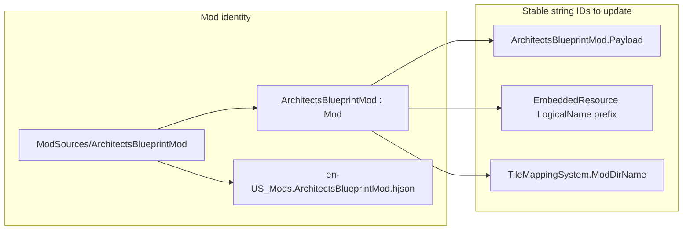

# Rename mod to Architect’s Blueprint / ArchitectsBlueprintMod

## Scope (confirmed)

- **Internal name / folder / assembly identity:** `ArchitectsBlueprintMod` (matches tModLoader convention: ModSources folder name = internal mod name).
- **Menu / branding:** set [`build.txt`](R:/Documents/My Games/Terraria/tModLoader/ModSources/ArchitectsStencilMod/build.txt) `displayName` to **Architect’s Blueprint** (or **Architect’s Blueprint Mod** if you want clearer separation from the Tier-5 item below).
- **Out of scope:** Tier-3 tool stays [`Content/Items/Tier3/ArchitectsStencil.cs`](R:/Documents/My Games/Terraria/tModLoader/ModSources/ArchitectsStencilMod/Content/Items/Tier3/ArchitectsStencil.cs), textures, and `ArchitectsStencil` localization keys unchanged.

**UX note:** Tier-5 [`Content/Items/Tier5/ArchitectsBlueprint.cs`](R:/Documents/My Games/Terraria/tModLoader/ModSources/ArchitectsStencilMod/Content/Items/Tier5/ArchitectsBlueprint.cs) already uses the display name **Architect’s Blueprint** in [`Localization/en-US_Mods.ArchitectsStencilMod.hjson`](R:/Documents/My Games/Terraria/tModLoader/ModSources/ArchitectsStencilMod/Localization/en-US_Mods.ArchitectsStencilMod.hjson). After the rename, consider tweaking that item’s **DisplayName** (e.g. “Architect’s Blueprint (relic)” or similar) so the mod title and item do not read identically in UI—that is a small localization-only follow-up, not required for the technical rename.

## 1. Rename repository root and project files (manual / git)

These renames are easiest done **outside** the IDE (close workspace first) or via `git mv` so history is preserved:

| From | To |
|------|-----|
| `ModSources/ArchitectsStencilMod/` | `ModSources/ArchitectsBlueprintMod/` |
| [`ArchitectsStencilMod.csproj`](R:/Documents/My Games/Terraria/tModLoader/ModSources/ArchitectsStencilMod/ArchitectsStencilMod.csproj) | `ArchitectsBlueprintMod.csproj` |
| [`ArchitectsStencilMod.sln`](R:/Documents/My Games/Terraria/tModLoader/ModSources/ArchitectsStencilMod/ArchitectsStencilMod.sln) | `ArchitectsBlueprintMod.sln` (recommended; update `Project(...)` line to new `.csproj` path and project name) |
| [`src/ArchitectsStencilMod.cs`](R:/Documents/My Games/Terraria/tModLoader/ModSources/ArchitectsStencilMod/src/ArchitectsStencilMod.cs) | `src/ArchitectsBlueprintMod.cs` |

Re-open the workspace from the **new** folder path.

## 2. Root `Mod` class and constants

In the renamed root file:

- `namespace ArchitectsBlueprintMod`
- `public sealed class ArchitectsBlueprintMod : Mod`
- `public const string ModInternalName = "ArchitectsBlueprintMod";`
- Update `ModContent.GetInstance<...>()` at [`PasteOverlayNetworking.cs`](R:/Documents/My Games/Terraria/tModLoader/ModSources/ArchitectsStencilMod/src/Core/Server/Execution/Networking/PasteOverlayNetworking.cs) and [`PayloadSerialization.cs`](R:/Documents/My Games/Terraria/tModLoader/ModSources/ArchitectsStencilMod/src/Core/Client/Payload/PayloadSerialization.cs) (and any other `GetInstance<ArchitectsStencilMod>`).

## 3. Namespaces and usings (bulk replace)

Replace root namespace **`ArchitectsStencilMod` → `ArchitectsBlueprintMod`** across all `.cs` files (every `namespace` and `using`, including nested roots like `ArchitectsStencilMod.Core` → `ArchitectsBlueprintMod.Core`).

Update [`GlobalSuppressions.cs`](R:/Documents/My Games/Terraria/tModLoader/ModSources/ArchitectsStencilMod/GlobalSuppressions.cs) `Target` entries to the new namespace strings.

## 4. Embedded resources (must stay consistent)

In [`ArchitectsStencilMod.csproj`](R:/Documents/My Games/Terraria/tModLoader/ModSources/ArchitectsStencilMod/ArchitectsStencilMod.csproj) (after rename, `ArchitectsBlueprintMod.csproj`), change every `LogicalName="ArchitectsStencilMod...."` to `ArchitectsBlueprintMod....` for:

- `LayerOrder.json`
- Test fixtures / goldens (`ASMTestFixture`, `GoldenPayloadClearCenter`, `GoldenPayloadFillCenter`)

Match code in:

- [`LayerSystem.cs`](R:/Documents/My Games/Terraria/tModLoader/ModSources/ArchitectsStencilMod/src/Core/Server/Execution/Layers/LayerSystem.cs) — `ResourceName` constant
- [`tests/PayloadIoTestScript.cs`](R:/Documents/My Games/Terraria/tModLoader/ModSources/ArchitectsStencilMod/tests/PayloadIoTestScript.cs) — three embedded resource name constants

## 5. Payload format and fixtures

- [`PayloadSerialization.cs`](R:/Documents/My Games/Terraria/tModLoader/ModSources/ArchitectsStencilMod/src/Core/Client/Payload/PayloadSerialization.cs): `PayloadFormat` → `ArchitectsBlueprintMod.Payload`; update `global::` type references and the user-facing string that mentions the **Payloads** folder (today it says `ArchitectsStencilMod`).
- [`tests/fixtures/ASMTest.asmpayload.json`](R:/Documents/My Games/Terraria/tModLoader/ModSources/ArchitectsStencilMod/tests/fixtures/ASMTest.asmpayload.json): `"format"` field to match.

## 6. Save-path directory for mapping / payloads on disk

[`TileMappingSystem.cs`](R:/Documents/My Games/Terraria/tModLoader/ModSources/ArchitectsStencilMod/src/Core/Server/Mapping/TileMappingSystem.cs) hardcodes `ModDirName = "ArchitectsStencilMod"` under `Main.SavePath`. Change to **`ArchitectsBlueprintMod`** so `SourceMaps`, `CompiledMaps`, and related output land under the new folder (no migration needed since there is no official release).

Update XML comments in the same file and [`ItrStorage.cs`](R:/Documents/My Games/Terraria/tModLoader/ModSources/ArchitectsStencilMod/src/Core/Server/Mapping/ItrStorage.cs) that still say `ArchitectsStencilMod\...`.

## 7. Recipe group and UI/debug string prefixes

- [`ArchitectRecipeGroups.cs`](R:/Documents/My Games/Terraria/tModLoader/ModSources/ArchitectsStencilMod/src/Systems/ArchitectRecipeGroups.cs): `EvilBossSummonGroupName` prefix `ArchitectsStencilMod:` → `ArchitectsBlueprintMod:` (any `RecipeGroup` registrations using the old string must stay in sync).
- [`PayloadFileDialogs.cs`](R:/Documents/My Games/Terraria/tModLoader/ModSources/ArchitectsStencilMod/src/Core/Client/Payload/PayloadFileDialogs.cs), [`ActionWheel.cs`](R:/Documents/My Games/Terraria/tModLoader/ModSources/ArchitectsStencilMod/src/Utils/ActionWheel.cs), [`OverlaySystem.cs`](R:/Documents/My Games/Terraria/tModLoader/ModSources/ArchitectsStencilMod/src/UI/OverlaySystem.cs): update hard-coded `"ArchitectsStencilMod:..."` / `"ArchitectsStencil:..."` tags to sensible new labels (e.g. `ArchitectsBlueprintMod: ...` and `ArchitectsBlueprint: Overlay`) so logs/UI stay grep-friendly.

## 8. Localization file rename

Rename:

- `Localization/en-US_Mods.ArchitectsStencilMod.hjson` → **`Localization/en-US_Mods.ArchitectsBlueprintMod.hjson`**

**Do not** rename the `Items.ArchitectsStencil` block key (that key tracks the Tier-3 item type name). Update only **comments** in item `.cs` files that still point at the old `.hjson` filename.

## 9. Editor / solution wiring

- [`.vscode/launch.json`](R:/Documents/My Games/Terraria/tModLoader/ModSources/ArchitectsStencilMod/.vscode/launch.json): `projectPath` → `ArchitectsBlueprintMod.csproj`; refresh the launch configuration **name** if desired.
- Solution file: project reference line after `.sln` / `.csproj` renames.

## 10. Docs (optional but low-cost)

Align high-level branding in [`README.md`](R:/Documents/My Games/Terraria/tModLoader/ModSources/ArchitectsStencilMod/README.md) and [`PLAN.md`](R:/Documents/My Games/Terraria/tModLoader/ModSources/ArchitectsStencilMod/PLAN.md) with **Architect’s Blueprint** / `ArchitectsBlueprintMod`. [`Content/Templates/INTERACTION_MAPS_TUTORIAL.md`](R:/Documents/My Games/Terraria/tModLoader/ModSources/ArchitectsStencilMod/Content/Templates/INTERACTION_MAPS_TUTORIAL.md) still references old folder names under `SavePath`—update those paths.

## 11. Verification

- `dotnet build` on `ArchitectsBlueprintMod.csproj` (or build from tML).
- Repo-wide search for `ArchitectsStencilMod` and `ArchitectsStencilMod.` in **source** (exclude `bin/`, `obj/`).
- In-game: confirm mod appears under the new name, payloads import/export, and mapping folders create under `Documents/My Games/Terraria/ArchitectsBlueprintMod/`.

No automated tests required per your project rules unless you explicitly want them run.
