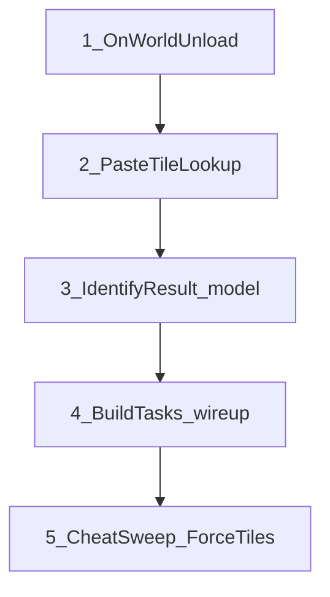
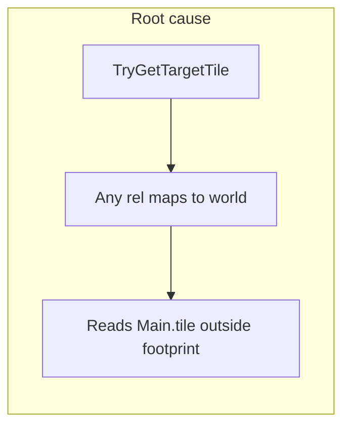

# World unload, blueprint bounds, PasteTileLookup, and Identify (finalized)

## Goals (short)

1. **World exit** — No stale blueprint, projection, paste op, or `ItrStorage` state after leaving a world.
2. **Bounds** — Identification and `PasteTile` creation never use relatives outside the paste footprint or disabled selection; neighbor/frame expansion is clamped or rejected (strict for anchored multitiles).
3. **Lookup** — Replace `SourceTileLookup` with `PasteTileLookup` (scoped source/target/world/rel queries).
4. **Identify** — Three outcomes per layer: plannable success, unplannable success (same tiles, **inventory missing required items**), or `null`. **Do not** evaluate frame anchors, target-world suitability, or other placement preconditions in Identify; those stay in the place/clear tasks where they already run.
5. **Force Tiles** — When `true` (default), only **plannable** identifications enqueue paste tasks; unplannable results kept for future overlay. When `false`, also enqueue unplannable.
6. **Cheat Sweep** — Config flag `CheatSweep` (label “Cheat Sweep”); cheat shortcut behavior as in current `Sweep()` path; default `false`.
7. **Future** — Store per-cell identify outcomes for ghost / “has items” tint; item checks shared with place/consume where practical.

## Suggested implementation order

1. **OnWorldUnload** — Low risk, unblocks correct behavior immediately.
2. **PasteTileLookup + clamps** — Fixes out-of-bounds bugs.
3. **Identify result model** — Change `Layer.Identify` + `LayerSystem.Identify`, then **BuildTasks** filtering (**missing items only** for `CanPlace`).
4. **Config** — `CheatSweep` / `ForceTiles` / `PasteContext` once paste path is stable.

---

## Problem summary (current code)

- **State survives world exit** — [`BlueprintSystem`](r:\Documents\My Games\Terraria\tModLoader\ModSources\ArchitectsStencilMod\src\Core\AreaSelection\BlueprintSystem.cs), [`ProjectionSystem`](r:\Documents\My Games\Terraria\tModLoader\ModSources\ArchitectsStencilMod\src\Core\AreaSelection\ProjectionSystem.cs), [`SelectionSystem`](r:\Documents\My Games\Terraria\tModLoader\ModSources\ArchitectsStencilMod\src\Core\AreaSelection\SelectionSystem.cs), [`PastingSystem`](r:\Documents\My Games\Terraria\tModLoader\ModSources\ArchitectsStencilMod\src\Core\PasteExecution\PastingSystem.cs): per-player arrays, no `OnWorldUnload`.
- **Identification outside blueprint** — [`Projection.TryGetTargetTile`](r:\Documents\My Games\Terraria\tModLoader\ModSources\ArchitectsStencilMod\src\Core\AreaSelection\Projection.cs) does not require `relative` inside the projection; [`FallBlockLayer.Identify`](r:\Documents\My Games\Terraria\tModLoader\ModSources\ArchitectsStencilMod\src\Core\PasteExecution\Layers\LayerOperations\FallBlockLayer.cs) can walk into adjacent world columns. [`FrameOperations.GetFrameTiles` / `GetFrameTilesAsBounded`](r:\Documents\My Games\Terraria\tModLoader\ModSources\ArchitectsStencilMod\src\Core\PasteExecution\Layers\LayerHelpers.cs) can emit relatives outside the rectangle.
- **PasteTile creation** — [`CreatePasteTiles`](r:\Documents\My Games\Terraria\tModLoader\ModSources\ArchitectsStencilMod\src\Core\PasteExecution\PastingSystem.cs) trusts `identified` lists from layers.

---

## 1. Graceful cleanup when leaving the world

Override **`OnWorldUnload`**; reset in this **order**:

| Order | System | Action |
|------:|--------|--------|
| 1 | [`PastingSystem`](r:\Documents\My Games\Terraria\tModLoader\ModSources\ArchitectsStencilMod\src\Core\PasteExecution\PastingSystem.cs) | Clear `_operations`; unlock projections; [`ItrStorage.Release()`](r:\Documents\My Games\Terraria\tModLoader\ModSources\ArchitectsStencilMod\src\Core\TileMapping\ItrStorage.cs) when empty (same as existing removal paths). |
| 2 | [`ProjectionSystem`](r:\Documents\My Games\Terraria\tModLoader\ModSources\ArchitectsStencilMod\src\Core\AreaSelection\ProjectionSystem.cs) | Every slot: clear all `Projections`, `ActiveProjection`, drag state (`ClearProjection` today only drops active — need full clear). |
| 3 | [`BlueprintSystem`](r:\Documents\My Games\Terraria\tModLoader\ModSources\ArchitectsStencilMod\src\Core\AreaSelection\BlueprintSystem.cs) | Every slot: reset points + `Blueprint.Clear()`. |
| 4 | [`SelectionSystem`](r:\Documents\My Games\Terraria\tModLoader\ModSources\ArchitectsStencilMod\src\Core\AreaSelection\SelectionSystem.cs) | Reset edit / `IsActive` state per slot. |

**Scope**: `OnWorldUnload` covers exit to menu / map unload. Multiplayer “one client disconnects” is out of scope unless you add `ModPlayer` later.

---

## 2. PasteTileLookup, bounds, and Identify

### 2A. `PasteTileLookup`

- New type (e.g. [`PasteExecution/PasteTileLookup.cs`](r:\Documents\My Games\Terraria\tModLoader\ModSources\ArchitectsStencilMod\src\Core\PasteExecution\PasteTileLookup.cs)); remove `SourceTileLookup` from [`LayerSystem.cs`](r:\Documents\My Games\Terraria\tModLoader\ModSources\ArchitectsStencilMod\src\Core\PasteExecution\Layers\LayerSystem.cs).
- **Rules**: `relative` must lie in the operation footprint (payload / `BuildTasks` coordinate spaces); `IsInPasteScope(rel)` matches selection semantics consistent with [`SnapshotSelectedTiles`](r:\Documents\My Games\Terraria\tModLoader\ModSources\ArchitectsStencilMod\src\Core\AreaSelection\Blueprint.cs) so neighbor expansion cannot enter deselected or out-of-rectangle cells.
- **API** (illustrative): `TryGetSource`, `TryGetTarget`, cut/source-area variant, `IsInPasteScope`, optional `RelativeToWorld` / `TryWorldToRelative`.

### 2B. Identify result model

Per layer, **`Identify` returns** (after geometric/tile-type identification only — **no** target-world frame validation):

| Outcome | Meaning |
|---------|---------|
| **Plannable success** | Layer owns the tile (incl. frame/neighbors); returns identified `BoundedTile` set; **player has all items** required for this layer’s place/consume for those tiles (respect `NeedsItems` / cheat modes same as paste). |
| **Unplannable success** | Same identified set; **required items missing** from inventory (when items are required). For future overlay (“can’t afford” hint). |
| **`null`** | Layer does not apply. |

[`LayerSystem.Identify`](r:\Documents\My Games\Terraria\tModLoader\ModSources\ArchitectsStencilMod\src\Core\PasteExecution\Layers\LayerSystem.cs) keeps current **`LayerType` first-wins** ordering but produces structured entries (e.g. `LayerIdentifyResult` with `Layer`, `Tiles`, `CanPlace`).

**Scope limit (explicit)** — `CanPlace` / unplannable is **only** “missing items” via existing `GetItem` / inventory checks. **Do not** add Identify-time logic that inspects whether the **target** world tiles satisfy frame anchors, slopes, adjacency, or other placement rules; placement tasks already handle success/failure and retries. That keeps Identify cheap and avoids duplicating heavy world analysis.

### 2C. `Layer.Identify` signature

- All layers: `PasteTileLookup` in, discriminated result or `null` out ([`Layer.cs`](r:\Documents\My Games\Terraria\tModLoader\ModSources\ArchitectsStencilMod\src\Core\PasteExecution\Layers\Layer.cs) + all implementations under `Layers/`). Item sufficiency can be resolved in `LayerSystem.Identify` after the layer returns its tile list, using the layer’s `GetItem` and `PasteContext`/slots, **or** a small shared helper — still **items only**.

### 2D. Frames and neighbors

- **Strict** for tile/wall/other anchored multitiles: if any frame cell is outside `IsInPasteScope`, return `null` (no partial frame identify).
- **FallBlock** (and similar): only read via `PasteTileLookup` so vertical walks stop at scope boundary.
- **`ClampIdentified`** before `CreatePasteTiles`; **`CreatePasteTiles`** never allocates `PasteTile` for `!IsInPasteScope`.

---

## 3. `BuildTasks` wiring

- Construct scoped **`PasteTileLookup`** instances for: target clear, source place, cut source (bounded to payload / `SourceBounds` rel space).
- Run structured **`LayerSystem.Identify`** per tile; then:
  - If **`ForceTiles`** (default **true**): enqueue **`QueueClearLayer` / `QueuePlaceLayer`** only when **`CanPlace`** (items OK).
  - If **`ForceTiles` false**: also enqueue from unplannable successes (missing items).
- Optionally stash unplannable (and plannable) results on **`PastingOperation`** by rel/world for future drawing (stub OK).

**`null` from all layers**: Keep or add Unknown/Sweep fallback as today; document interaction with **`ForceTiles`** in code comments.

---

## 4. Config: Cheat Sweep and Force Tiles

First release: introduce these names directly (**no** `LegacyName` / config migration).

| Setting | Default | Behavior |
|---------|---------|----------|
| **Cheat Sweep** (`CheatSweep`) | `false` | Cheat path: [`Sweep()`](r:\Documents\My Games\Terraria\tModLoader\ModSources\ArchitectsStencilMod\src\Core\PasteExecution\PastingSystem.cs), drain clears, Wall/Fluid/Sweep cheat place. Display label: “Cheat Sweep”. |
| **Force Tiles** (`ForceTiles`) | `true` | `true` → only plannable (items OK) identifications become paste tasks; `false` → also queue when items missing. Pass via [`PasteContext`](r:\Documents\My Games\Terraria\tModLoader\ModSources\ArchitectsStencilMod\src\Core\PasteExecution\PasteTypes.cs). Use **`CheatSweep`** on `PasteContext` for `WorldGen.PlaceTile` `forced:` / consume behavior in [`LayerHelpers`](r:\Documents\My Games\Terraria\tModLoader\ModSources\ArchitectsStencilMod\src\Core\PasteExecution\Layers\LayerHelpers.cs) (replace any `ForcePaste` field there with `CheatSweep`). |

---

## 5. Files touched (checklist)

- **New**: `PasteTileLookup.cs`; type(s) for `LayerIdentifyResult` (beside `LayerSystem` or `PasteTypes`).
- **Core**: [`LayerSystem.cs`](r:\Documents\My Games\Terraria\tModLoader\ModSources\ArchitectsStencilMod\src\Core\PasteExecution\Layers\LayerSystem.cs), [`Layer.cs`](r:\Documents\My Games\Terraria\tModLoader\ModSources\ArchitectsStencilMod\src\Core\PasteExecution\Layers\Layer.cs), all `Layers/**/*Layer.cs`, [`LayerHelpers.cs`](r:\Documents\My Games\Terraria\tModLoader\ModSources\ArchitectsStencilMod\src\Core\PasteExecution\Layers\LayerHelpers.cs), [`PastingSystem.cs`](r:\Documents\My Games\Terraria\tModLoader\ModSources\ArchitectsStencilMod\src\Core\PasteExecution\PastingSystem.cs), [`PasteTypes.cs`](r:\Documents\My Games\Terraria\tModLoader\ModSources\ArchitectsStencilMod\src\Core\PasteExecution\PasteTypes.cs).
- **Config**: [`PastingConfig.cs`](r:\Documents\My Games\Terraria\tModLoader\ModSources\ArchitectsStencilMod\src\Config\PastingConfig.cs).
- **Optional**: tighten [`Projection.TryGetTargetTile`](r:\Documents\My Games\Terraria\tModLoader\ModSources\ArchitectsStencilMod\src\Core\AreaSelection\Projection.cs) if any non-paste caller needs parity; paste path should prefer `PasteTileLookup` only.

---

## 6. Verification (manual)

- Paste in progress → return to menu → re-enter: no ghost blueprint/projection; no locked projection; `ItrStorage` not stuck.
- Edge paste (sand column, large furniture at blueprint border): no clears/places outside footprint.
- **Force Tiles** on: strip inventory of a required place item → identify marks unplannable; **no** place task for that tile (overlay later reflects “missing items” only—not frame validity).
- **Cheat Sweep** on: still completes via Wall/Fluid/Sweep shortcut in one update style as today.

---

*Plan finalized for implementation. First version: no saved-config migration.*
